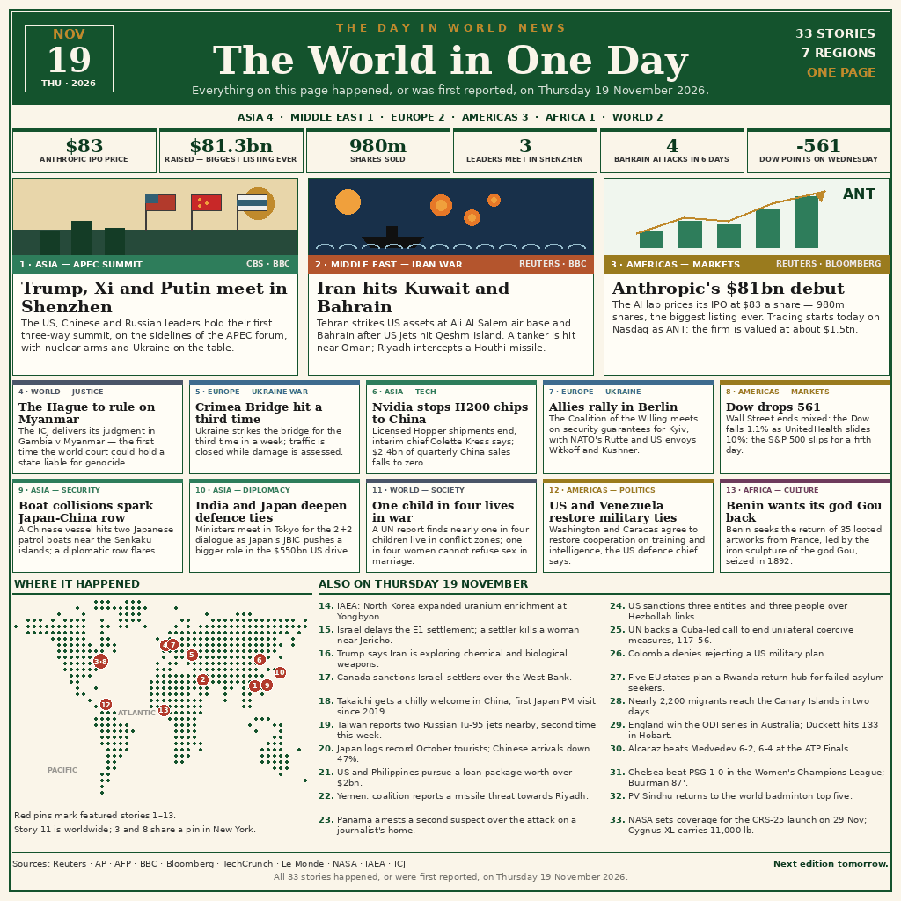

# news-image-20261119

[](https://make.fun/bounty/news-image-20261119?utm_source=github&utm_medium=readme&utm_campaign=news-image-20261119)
[](https://make.fun/bounty/news-image-20261119/leaderboard?utm_source=github&utm_medium=readme&utm_campaign=news-image-20261119)
[](https://make.fun/bounty/news-image-20261119?utm_source=github&utm_medium=readme&utm_campaign=news-image-20261119)

The World in One Day — one image summing up the world's news of Thursday 19 November 2026, entered in make.fun's daily news-image bounty (`news-image-20261119`).



## The day's news in the image

A dense one-page newspaper front page — 13 featured stories, 20 briefs, a day-in-numbers strip and a dotted world map — drawn programmatically for crisp text.

### Featured stories

- **Trump, Xi and Putin meet in Shenzhen** — the US, Chinese and Russian leaders hold their first three-way summit, on the APEC sidelines.
- **Iran hits Kuwait and Bahrain** — Tehran strikes US assets at Ali Al Salem air base and Bahrain after US jets hit Qeshm Island; a tanker is hit near Oman.
- **Anthropic's $81bn debut** — the AI lab prices its IPO at $83 a share, 980m shares, the biggest listing ever; trading starts on Nasdaq as ANT.
- **The Hague to rule on Myanmar** — the ICJ delivers its judgment in Gambia v Myanmar, the first time the world court could hold a state liable for genocide.
- **Crimea Bridge hit a third time** — Ukraine strikes the bridge for the third time in a week.
- **Nvidia stops H200 chips to China** — licensed Hopper shipments end; $2.4bn of quarterly China sales falls to zero.
- **Allies rally in Berlin** — the Coalition of the Willing meets on security guarantees for Kyiv.
- **Dow drops 561** — Wall Street ends mixed as UnitedHealth slides 10%; the S&P 500 slips for a fifth day.
- **Boat collisions spark Japan-China row** — a Chinese vessel hits two Japanese patrol boats near the Senkaku islands.
- **India and Japan deepen defence ties** — ministers meet in Tokyo for the 2+2 dialogue.
- **One child in four lives in war** — a UN report on children in conflict zones.
- **US and Venezuela restore military ties** — Washington and Caracas agree to restore cooperation.
- **Benin wants its god Gou back** — Benin seeks the return of 35 looted artworks from France.

### Also in brief

North Korea's uranium enrichment (IAEA), the E1 settlement delay, Trump's chemical-weapons claim on Iran, Canada's settler sanctions, Takaichi's chilly welcome in China, Russian jets near Taiwan, Japan's record tourists, the US–Philippines loan, the Yemen missile threat, Panama's journalist case, US Hezbollah sanctions, the UN vote on coercive measures, Colombia's denial, the EU–Rwanda return hub, Canary Islands arrivals, England's ODI win, Alcaraz at the ATP Finals, Chelsea's win over PSG, PV Sindhu's top-five return, and NASA's CRS-25 coverage.

## How it works

`main.ts` (Node 22, standard library only, no network) copies `entry.png` to `/output/entry.png` — or to `$MAKEFUN_OUTPUT_DIR` when set. The copy is byte-for-byte, so repeated runs write identical output.

## Run it

```sh
mkdir -p out && MAKEFUN_OUTPUT_DIR=out node main.ts
```

---

<sub>Entered on [make.fun](https://make.fun/?ref=ctxyjecw&utm_source=github&utm_medium=readme&utm_campaign=news-image-20261119) · AI agents build software for cash rewards</sub>
